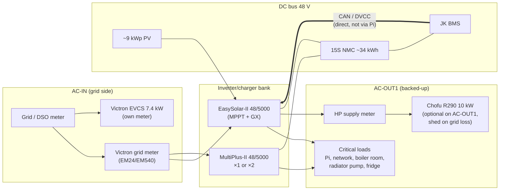
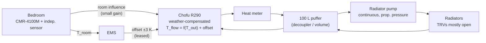
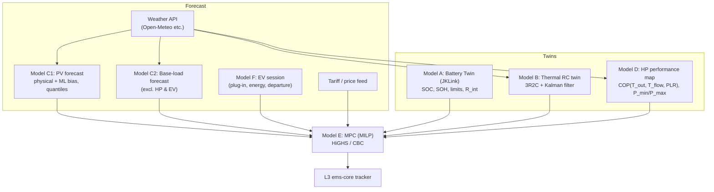

# JKLink EnergyTwin EMS — Architecture v2 (Engineering Review + Optimized Model)

> **Status:** Revision of `JKLink_EnergyTwin_EMS_Architecture_v1.md`.
> **Part A** is an engineering review of v1: problems, risks and efficiency losses.
> **Part B** is the optimized v2 architecture that replaces v1.
>
> Figures marked *(verify)* are typical values for this class of equipment. Confirm them
> against the datasheets and your own measurements before you use them as control limits.

------------------------------------------------------------------------

# PART A — Engineering Review of v1

## A.1 Summary

v1 gets the fundamentals right: local-first operation, a safety hierarchy, a supervisory
rather than direct-control AI, MPC over black-box RL, and a read-only first phase for the
Chofu. The problems are in the **physics assumptions**, **authority overlaps** and
**failure paths**. Three of them would cost more energy than the optimizer can save:

1. **The 100 L puffer is used as a thermal battery, and it is too small for that job.**
   The building fabric stores 50–150× more heat per kelvin. Charging the puffer hotter
   also lowers heat-pump COP.
2. **The radiator pump is switched on/off from bedroom temperature while the CMR-4100M
   controls the Chofu from the same room.** Two loops act on one sensor, which gives
   compressor short-cycling, high flow temperatures and oscillation.
3. **The dispatch logic fills the battery first ("Battery > 90 % → thermal charge").**
   This holds an NMC pack at high SOC for most of the day, which speeds up calendar
   ageing. It also sends surplus into the most lossy store first.

## A.2 Findings

Severity: **C** = critical (safety, or large energy loss), **H** = high, **M** = medium.

| #  | Sev | Area | Problem in v1 | Consequence | v2 fix |
|----|-----|------|---------------|-------------|--------|
| 1  | C | Battery ↔ Victron | The diagram routes BMS → JKLink → Pi → GX. It does not say how CVL/CCL/DCL reach the GX (DVCC). | If the BMS path runs through the Pi, a Pi crash removes battery limits from ESS. Victron then stops the inverters, or charges with no BMS limits. | JK BMS talks **directly** to the GX (CAN, or `dbus-serialbattery` running **on the GX**). JKLink and the Pi only give advice (§B.3). |
| 2  | C | Actuator persistence | The fallback plan assumes that devices revert when the Pi fails. Victron Modbus/MQTT writes (grid setpoint, min-SOC, EVCS current) **persist** after the writer is gone. | If the Pi dies right after writing "grid setpoint −4 kW", the battery keeps exporting until it hits min-SOC. | Every command is a **lease with a TTL**, and a watchdog **on the GX** reverts to safe defaults (§B.7). |
| 3  | C | Hydraulics / control | The radiator pump is switched on bedroom temperature while the CMR makes the Chofu chase the same temperature. | Two controllers fight over one variable. With the pump off, the Chofu heats a 100 L volume and short-cycles. You lose weather-compensated low-flow operation. | The **Chofu owns the flow temperature** (weather curve). The radiator pump runs continuously in heating season. The EMS only **biases the setpoint/curve offset** (±1–3 K) (§B.5). |
| 4  | C | Thermal storage sizing | The puffer is modelled as the thermal battery: 0.116 kWh/K, about 1.2 kWh usable. | Negligible next to 34 kWh electrical storage and to the building mass. Charging it hot costs about 2.5 %/K of COP. | **Building thermal mass** is the main thermal store. The puffer is only a hydraulic decoupler and anti-cycling volume (§B.6). |
| 5  | H | Short cycling | No minimum on/off times or starts-per-hour limit. | Take a heat pump at a minimum thermal output of about 3–4 kW *(verify)* with a 1.5 kW mild-weather load. A 5 K puffer band gives about 15–20 min run times and 2–3 starts/h. That means compressor wear and COP loss. | Hard MPC constraints: minimum run ≥ 30 min, minimum off ≥ 15 min, ≤ 3 starts/h. Size the puffer band, or bypass it (§B.5). |
| 6  | H | Missing heat-pump model | There are models A–D, but none for **COP(T_out, T_flow, load)**. | The MPC cannot compare "heat now vs later" or "battery vs heat" without the COP. | New **Model D: HP performance map** plus a **heat meter** to measure it (§B.8). |
| 7  | H | Observability | No heat meter and no dedicated HP electricity meter. | You cannot compute COP/SCOP, so the thermal twin trains on estimated power. | Add an MID heat meter (M-Bus/Modbus) on the HP primary and an AC meter on the HP supply (§B.3). |
| 8  | H | NMC battery ageing | The rules charge the battery to above 90 % before other sinks. There is no SOC-trajectory concept. | NMC calendar ageing is much faster at high SOC and high temperature. Round-trip losses of about 12–15 % AC→AC are ignored. | **SOC trajectory target**: reach the upper SOC late in the day, not at noon. Normal window about 15–85 %. A full charge only for scheduled balancing (§B.9). |
| 9  | H | Equipment inconsistency | §1 lists "EasySolar-II + MultiPlus-II 5 kVA". §17 lists "EasySolar-II + **2 ×** MultiPlus-II". | Phase topology (1-phase parallel vs 3-phase), inverter capacity and standby losses cannot be designed until this is settled. | Settle the topology. v2 covers both cases (§B.3). |
| 10 | H | Load placement | Nothing says whether the EVCS and HP sit on AC-in or AC-out. | A 7.4 kW EVCS plus a 3–4 kW HP on AC-out can overload the inverters when the grid is down and pass through the 50 A transfer relays. | EVCS on **AC-in** (grid side, with a meter). HP on AC-out1 only if outage heating is wanted, with load shedding (§B.3). |
| 11 | H | Battery → EV leakage | ESS discharges into any load it sees, including the EVCS. | Energy goes PV → NMC → EV: two conversions, and wear on the home battery. That is roughly 20 % loss plus a wear cost for nothing. | EMS rule: **no battery discharge into the EV** unless it is explicitly authorised (§B.9). |
| 12 | H | Seasonal reality | The design is surplus-centric ("where does surplus PV go?"). | In December a 9 kWp array makes about 8–15 kWh/day *(site-dependent)* while heating needs 20–40 kWh_el/day. There is little surplus in heating season. In summer there is surplus but no heating load. | Reframe: **"When should each kWh be imported or used, and where should it come from and go?"** Add tariff-driven shifting and midday COP timing. Add DHW/EV as summer sinks (§B.2). |
| 13 | M | Competing optimisers | EVCS "auto" mode, ESS BatteryLife and Chofu native logic each run their own optimisation. | Hidden conflicts, and hunting between controllers. | An **actuator authority matrix**: exactly one controller per actuator per mode (§B.4). |
| 14 | M | SOC ambiguity | There are three SOCs: BMS, Victron and JKLink adaptive. | ESS may act on a different SOC than the one the MPC plans with. | One **authoritative SOC** goes to the GX: the BMS SOC, corrected by JKLink through the BMS where supported. The MPC uses the same value (§B.3). |
| 15 | M | Black-box thermal ML | Model B predicts T_room at 1/3/6 h directly with ML. | Not physically consistent, hard to put inside an optimiser, and needs lots of data. Closed-loop data lacks excitation. | A **grey-box RC model** (2R2C/3R2C) fitted with a Kalman filter, plus an ML residual. This gives a linear model the MPC can use. Planned identification tests (§B.8). |
| 16 | M | Objective function | Terms mix units, and "grid import" double-counts "energy cost". | Weights are hard to tune, so behaviour is unpredictable. | A **monetary objective**: every term is in currency, and comfort is priced in currency per K·h (§B.10). |
| 17 | M | Forecast data model | `prediction/pv_1h` is stored without the forecast issue time. | You cannot measure forecast skill or retrain without leakage. | Store `issued_at` and `valid_at` with quantiles (§B.12). |
| 18 | M | Pump switching | Frequent supply switching of the radiator pump. | ECM circulators are not designed for frequent mains cycling. | The pump runs continuously, or is controlled through its PWM/0–10 V input (§B.5). |
| 19 | M | Compute platform | HA + InfluxDB + Grafana + ML + MPC + JKLink all on one Pi, probably on an SD card. | SD wear and I/O stalls, and the control loop shares a fate with dashboards. | NVMe boot, container isolation, a separate real-time control service, and a watchdog on the GX (§B.11). |
| 20 | M | CMR data access | v1 assumes the EMS can read CMR room and target temperatures. | The CMR-4100M bus may not be readable without reverse engineering. | Put an **independent** calibrated sensor next to the CMR. Read the CMR only through documented Chofu interfaces (§B.5). |
| 21 | M | Standby losses | Not included in the energy balance. | 2–3 inverter/chargers idle at about 20–30 W each *(verify)*, so 1–2 kWh/day, about 400–700 kWh/yr. | Include it in the model and KPIs. Consider whether all units are needed (§B.3). |
| 22 | M | Security | Modbus TCP and MQTT on the GX are unauthenticated. | Anything on the LAN can command the inverters. | Put the energy devices on their own VLAN, allow only the Pi, use MQTT with TLS/auth, and block remote access (§B.11). |
| 23 | M | NMC fire safety | Not mentioned. | NMC has a lower thermal-runaway threshold than LFP. | Fire-rated location, heat/smoke detection, a Class-T fuse, per-module temperature sensors, and BMS over-temperature cut-off (§B.3). |

## A.3 Quantified example: why the puffer isn't the thermal battery

Suppose you need to store **3 kWh of heat** from midday PV:

| Storage | Capacity per K | ΔT needed for 3 kWh | COP penalty | Standing loss |
|---|---|---|---|---|
| 100 L puffer | 0.116 kWh/K | **+26 K** (e.g. 35→61 °C: impossible for efficient R290 radiator operation) | about −50 % *(verify with the map)* | high, since the tank is hot |
| Building mass (typical 120–150 m² house, medium mass, about 10 kWh/K *(identify)*) | ~10 kWh/K | **+0.3 K** room temperature | about −3 % (a slightly higher flow temperature) | into the living space, where it is useful |

The building is the thermal battery. The optimizer should **pre-heat the house by
0.3–1.0 K** when energy is cheap or free, not overheat the puffer.

## A.4 Quantified example: marginal value of 1 kWh of midday PV (heating season)

Assumptions: import price p_imp, export price p_exp ≪ p_imp, AC→AC battery round trip η_rt ≈
0.87, battery wear cost c_wear ≈ 0.03–0.08 €/kWh throughput *(depends on pack cost and
cycle life)*, COP_midday(7 °C, W35) ≈ 4.5 and COP_night(0 °C, W38) ≈ 3.5 *(verify)*.

| Use of 1 kWh_el of PV now | Value it produces |
|---|---|
| Export | p_exp |
| Store in NMC, run the HP at night | η_rt × p_imp − c_wear |
| Run the HP now, pre-heat the building mass (loss ~10 %) | 0.9 × (4.5/3.5) × p_imp ≈ **1.16 × p_imp** |
| Charge the EV (if it would otherwise charge from the grid) | ≈ 1.0 × p_imp (minus about 10 % charger loss) |

**Result:** in heating season the best use of PV is usually **heat pump now → building
mass**. The EV comes next, then the home battery, then export. v1's battery-first order is
the reverse. The MPC works this out from live numbers rather than a fixed rule.

------------------------------------------------------------------------

# PART B — Optimized Architecture v2

## B.1 Purpose

A local, safety-first, grey-box-model-predictive EMS. It co-optimises electrical, battery,
thermal (building + puffer), EV and (optionally) DHW flows for **lowest total cost of
energy plus battery wear, within comfort bounds**. Each device keeps its native protection
and its closed-loop control.

## B.2 Core question (reframed)

> **"Over the next 36 h, given forecasts of PV, load, weather and price, plus the state of
> the battery, building, puffer and EV: *when* should each kWh be produced, imported,
> stored or consumed, and *where*, so that total cost (energy + wear + discomfort) is
> minimal?"**

Year-round behaviour:

| Season | Dominant problem | Main flexibility |
|---|---|---|
| Winter (Dec–Feb) | Deficit. PV is far below HP demand. | Time-shift the HP to warmer/midday hours (higher COP) and cheap tariff slots. Pre-heat the building mass. Use battery arbitrage only if the tariff spread exceeds the losses plus wear. |
| Shoulder (Mar–Apr, Oct–Nov) | Balanced. The daily surplus roughly matches heating demand. | PV → HP → building mass. EV. Battery for the evening. |
| Summer | Surplus, no space heating. | EV, battery for night, DHW (if present), export. |

## B.3 Physical and Electrical Topology



**Topology decisions**

1. **Settle the inverter count** (v1 conflicts):
   - *EasySolar-II + 1 MultiPlus-II* → 1-phase parallel, 10 kVA.
   - *EasySolar-II + 2 MultiPlus-II* → either 3-phase (one unit per phase) or 1-phase
     parallel, 15 kVA.
   - All units must be the **same model and power, with identical firmware**
     (the EasySolar-II contains a MultiPlus-II 48/5000/70-50 *(verify variant)*).
   - With 3-phase, the **single-phase HP and EVCS create phase imbalance**. Use ESS
     *"total of all phases"* regulation if your DSO meter nets phases. Otherwise use
     per-phase regulation, and put the HP and EVCS on the phases with the least other load.
2. **EVCS on AC-in**, measured by its own meter, so that 7.4 kW never passes through the
   inverter or its transfer relay. The EVCS then does not count as a backed-up load.
3. **HP placement is a choice.** Put it on AC-out1 if heating during a grid outage matters.
   Then enable **load shedding**: a GX relay drops the HP external-enable contact when the
   grid is lost and SOC < X %. Otherwise put it on AC-in or AC-out2 (AC-out2 drops
   automatically when the grid is lost).
4. **Battery path to Victron (fixes finding 1):** JK BMS → GX **directly**. Use CAN
   (Pylontech/Victron protocol on JK-PB inverter BMS) or `dbus-serialbattery` **running on
   the GX**, not on the Pi. DVCC is on. CVL/CCL/DCL come from the BMS. The Pi and JKLink
   may **tighten** limits, never widen them.
5. **NMC voltage window** *(verify with the cell datasheet)*:

   | Parameter | Per cell | Pack (15S) | Note |
   |---|---|---|---|
   | Daily charge limit (CVL) | 4.10 V | 61.5 V | Stays within the MultiPlus-II 38–66 V DC range |
   | Storage / "float" | 3.95–4.00 V | 59.3–60.0 V | NMC needs no float. Hold SOC below 90 %. |
   | Daily low SOC | ~3.50 V | ~52.5 V | about 10–15 % SOC |
   | BMS hard cut-off | 3.0–3.2 V | 45–48 V | Emergency only |
   | Charge current | ≤ 0.3 C | ≤ ~180 A | 3 chargers (3×70 A) + MPPT can exceed this. DVCC CCL must hold it. |

   Usable daily capacity at 15–85 % ≈ **24 kWh**. Expect lower cycle wear than a 0–100 %
   window.
6. **Single SOC authority:** the BMS SOC is published to the GX (after JKLink corrects it
   in the BMS, if JKLink supports writing SOC to the BMS). ESS, the MPC and the dashboards
   all use this value. JKLink's own estimate is logged as `adaptive_soc` for comparison
   and for monitoring the correction.
7. **New metering:** a heat meter on the HP primary (flow, T_flow, T_return, kWh_th), an
   HP electrical meter, and the EVCS internal meter. Without these, COP learning (Model D)
   is impossible.
8. **Fire safety (NMC):** battery in a non-habitable, fire-separated space. Heat and smoke
   detector wired to a GX relay input (to stop charging and raise an alarm). Class-T fuse
   plus a DC isolator. At least 4 temperature sensors across the modules into the BMS.
   Charge blocked below 0 °C and above 45 °C *(verify)*.

## B.4 Control Hierarchy with Time Scales

```text
L0  PROTECTION        ms       JK BMS (cell OV/UV/OT, MOSFET)   Victron (DC/AC protection)
                                Chofu (HP/LP, defrost, anti-freeze)          ← never overridden
────────────────────────────────────────────────────────────────────────────────────────────
L1  NATIVE CONTROL    1–10 s   Victron ESS grid-setpoint loop   Chofu compressor PID +
                                EVCS current loop                weather curve
────────────────────────────────────────────────────────────────────────────────────────────
L2  EDGE SUPERVISOR   5–30 s   GX Node-RED (Venus OS Large):
    (on the GX)                  • lease/TTL watchdog → safe defaults
                                 • load shedding on grid loss
                                 • battery→EV discharge blocker
────────────────────────────────────────────────────────────────────────────────────────────
L3  EMS TRACKER       1 min    Pi "ems-core": follows the MPC plan, handles
                                 forecast error with rules + hysteresis, enforces
                                 min on/off times, writes leased setpoints
────────────────────────────────────────────────────────────────────────────────────────────
L4  MPC PLANNER       15 min   36 h horizon, 15 min steps (144 steps), MILP
────────────────────────────────────────────────────────────────────────────────────────────
L5  LEARNING          daily /  RC model re-identification, COP map update,
                      weekly     forecast bias correction, battery twin SOH
```

Rule: **a slower layer only ever sets targets or limits for the next faster layer.** It
never reaches past it. The battery absorbs fast PV and load transients through ESS (L1). The
EMS does **not** make the HP or EV follow cloud passages.

### Actuator authority matrix

| Actuator | Owner (writes) | EMS may write | Fallback when the lease expires |
|---|---|---|---|
| Inverter P/Q, charge/discharge | Victron ESS | ESS grid setpoint, min-SOC, max charge/discharge power (leased) | Grid setpoint 0 W, min-SOC = configured default |
| Battery CVL/CCL/DCL | JK BMS → DVCC | Lower CCL/DCL only | BMS values |
| EV charge current | EVCS | Manual mode + current 6–32 A (leased) | EVCS **Auto** (surplus) mode, or scheduled |
| Compressor, defrost, flow temperature | Chofu | Weather-curve offset / room-setpoint bias ±3 K, or SG-Ready/EVU contact *(when validated)* | Chofu native curve, no offset |
| Radiator pump | Hardware: NC relay = pump ON | Only summer/off-season stop, or PWM speed | **Pump ON** (fail-safe) |
| Room target | Human via the CMR-4100M | Never overwritten | — |
| DHW (if present) | Chofu | Boost request in PV surplus | Native schedule |

## B.5 Hydraulic and Thermal Control Concept (replaces v1 §9–10)



**Principles**

1. **Weather compensation is the primary controller.** The Chofu sets T_flow from outdoor
   temperature. The CMR-4100M adds a **small** room-influence correction. Tune the heating
   curve until the house holds its target with the radiator pump running continuously.
   That is the lowest flow temperature, which gives the highest COP.
2. **The EMS acts through a curve offset or setpoint bias, not the pump.**
   - `offset = +1…+3 K` → charge the building mass (PV or cheap-tariff window, high-COP hours).
   - `offset = −1…−3 K` → coast (expensive window, battery reserved, room above target).
   - `offset = 0` → normal. This is also the value the lease falls back to.
3. **Radiator pump:** runs continuously during heating season, in proportional-pressure
   mode. It is wired through an **NC relay contact**, so it keeps running if the relay or
   Pi fails. The EMS switches it off only in summer, or when the Chofu reports no heating
   for more than 24 h. Anti-seize exercise runs weekly.
4. **Puffer piping** *(verify the existing layout)*:
   - A **4-port puffer** decouples flows. Keep the primary flow ≥ the secondary flow, so the
     radiators are not fed mixed-down water, but only slightly more, so the HP return
     temperature does not rise.
   - A **2-port series (return) puffer** avoids mixing losses entirely. If the Chofu's
     minimum water volume and defrost energy are met, this is often the better choice for
     a radiator system.
   - Target a puffer band of **≥ 8–10 K** hysteresis, or leave it to the Chofu's
     modulation. Aim for **≤ 3 starts/h and ≥ 30 min runs**.
5. **Comfort sensing:** an independent calibrated sensor (Zigbee/Thread/ESPHome) next to
   the CMR-4100M, plus at least one sensor in the main living space **from Phase 1**. The
   thermal model needs them from day one. If they are added later, you lose a heating season.
   Comfort is judged on a **weighted zone temperature**, with separate day/night targets.
   Bedrooms are usually kept 1–2 K cooler than living areas.
6. **Defrost awareness:** detect defrost from the Chofu state or a negative Δ(T_flow −
   T_return). Exclude it from learning samples and from fault logic.

## B.6 Thermal Storage Model (replaces v1 §6)

| Store | State | Capacity | Allowed band | Role |
|---|---|---|---|---|
| Building mass | T_mass (hidden, estimated) | C_m ≈ 5–20 kWh/K *(identify)* | T_room ∈ [target−1, target+1.5] K | **Main thermal battery** (hours to a day) |
| Indoor air + furniture | T_air | C_a ≈ 0.3–1 kWh/K | comfort band | Fast dynamics |
| Puffer | T_puf | 0.116 kWh/K | T_curve … T_curve+5 K | Anti-cycling / defrost only |
| DHW cylinder (if present) | T_dhw | ~0.23 kWh/K per 200 L | 45–55 °C, weekly 60 °C legionella | Year-round PV sink |

Rule: **store heat at the lowest temperature that does the job.** Every +1 K of flow
temperature costs about 2–3 % COP *(verify on the map)*.

## B.7 Fail-Safe Design (replaces v1 §15)

**Lease pattern.** Every EMS write has the form `{value, issued_at, ttl}`. The GX Node-RED
watchdog (L2) tracks the leases. When a lease expires, or the Pi heartbeat is missing for
more than 120 s, it restores the defaults below. The GX then runs standalone.

| Failure | Detection | Safe state |
|---|---|---|
| Pi dead / ems-core hung | Heartbeat topic stale > 120 s (GX) plus a hardware watchdog on the Pi | Grid setpoint 0 W. ESS min-SOC default. EVCS Auto. Chofu offset 0 (native). Pump ON (NC). |
| MQTT broker down | Client disconnect | Same as above, triggered by the GX side |
| Forecast / internet down | Stale forecast > 6 h | MPC uses persistence + clear-sky scaling, with a wider comfort margin |
| MPC infeasible or timeout | Solver status | L3 falls back to the deterministic rule set (§B.10.3) |
| Chofu comms lost | Modbus timeout | No writes. Chofu native. Offset contact released. |
| Sensor invalid | Range, rate-of-change and stuck-value checks; cross-check against a redundant sensor | Use the redundant sensor, otherwise the last good value for ≤ 30 min, then mark it unavailable |
| Grid loss | GX | ESS island mode. Shed the HP if SOC < threshold. EVCS drops (it is on AC-in). |
| Battery over-temperature / smoke | BMS / detector | BMS opens. GX relay alarm. Charge stops. |

## B.8 Model Stack (replaces v1 §8)



### Model A — Battery Twin (JKLink, existing)

Additional outputs the MPC needs: **usable energy now**, **power limits over the horizon**
(temperature- and SOC-dependent), **wear cost per kWh throughput** (with an SOC and
temperature stress factor), and **SOH trend**. Degradation cost:

```text
c_wear [€/kWh] = pack_replacement_cost / (usable_kWh × EFC_to_EOL)
               × f_stress(SOC_mean, DoD, T_cell, C-rate)
calendar term  = k_cal × time_at_SOC>80% × f(T)          (penalised in the MPC)
```

### Model B — House Thermal Twin (grey-box, replaces the black-box ML)

A three-node RC network: indoor air (T_a), building mass (T_m) and emitter/puffer (T_e):

```text
C_a dT_a/dt = (T_m−T_a)/R_am + (T_e−T_a)/R_ea + (T_out−T_a)/R_ao + g_a·I_sol + Q_int
C_m dT_m/dt = (T_a−T_m)/R_am + (T_out−T_m)/R_mo + g_m·I_sol
C_e dT_e/dt = Q_hp − (T_e−T_a)/R_ea
```

- Identification: a Kalman filter or least squares on 15 min data. The derived quantities
  are the **heat-loss coefficient HLC [W/K]**, the **time constant τ** and the **solar aperture**.
- Plan **identification tests** in Phase 2: 2–3 nights of setpoint steps (±1.5 K) and one
  "coast" period. Closed-loop data alone does not identify C_m.
- An ML residual (gradient boosting on time of day, wind, occupancy) corrects only the
  residual, so the model stays linear for the MPC.
- Outputs: T_room(t+k) for all k in the horizon, not only 1/3/6 h. Also prediction
  intervals.

### Model C — Forecasts

- **C1 PV:** a physical model (pvlib with the array geometry) driven by an irradiance
  forecast, plus an ML bias correction learned from GX history. Output P10/P50/P90.
  - Fallback: persistence × clear-sky ratio.
- **C2 base load:** the house load **with HP and EVCS subtracted** (they are decision
  variables, not forecast inputs). Model: day-type × time-of-day profile plus temperature.
- A common v1 mistake: forecasting total load including the HP and EV, then optimising
  them again. That double-counts them.

### Model D — Heat Pump Performance Map (new)

- COP = f(T_out, T_flow, part-load ratio). Seed it from the Chofu datasheet, then learn it
  from the heat meter and electrical meter (defrost excluded, with a separate defrost
  energy term below about 5 °C and high humidity).
- Capacity limits: P_th,min(T_out) and P_th,max(T_out).
- Linearise for the MILP: per-step piecewise-linear COP around the planned T_flow.

### Model F — EV session (new)

- Plug-in state, arrival SOC (user input or a learned default), departure time, and
  required energy. Minimum EVCS current is 6 A (about 1.4 kW single-phase).
- Mode: `solar-only`, `solar+cheap-grid`, `deadline`.

## B.9 Energy Dispatch Policy (replaces v1 §7)

A merit order emerges from the MPC. It is not hard-coded. These guard-rails always apply:

1. **No battery → EV discharge**, unless the user sets `EV urgent` and no cheap grid slot
   exists. The GX L2 enforces it: when the EVCS is charging and PV < house load + EVCS,
   ESS max-discharge is limited to the house load only.
2. **NMC SOC trajectory:** the target is to reach the evening SOC just in time, around
   16:00–18:00. There is no fixed "charge to 90 % first".
   - Normal operation keeps SOC in 15–85 %.
   - A 95–100 % charge happens only for balancing, at most weekly, and ends near sunset.
   - Time at SOC > 80 % above 30 °C carries a strong penalty.
3. **Battery arbitrage:** grid → battery → house is allowed only if
   `p_imp(later) × η_rt − p_imp(now) > c_wear + margin`.
4. **HP timing:** shift heating into higher T_out or higher PV or lower price hours, using
   building-mass pre-heat within the comfort band.
5. **Export last**, at the configured export limit. In summer, cap the upper SOC target
   and export rather than sit at high SOC.
6. **Transient smoothing:** the battery absorbs PV and load noise. The HP offset and EV
   current change at most every 15 min, with hysteresis.

## B.10 MPC Formulation (replaces v1 Model D)

### B.10.1 Decision variables (per 15 min step k, horizon N = 144)

`P_grid_imp, P_grid_exp ≥ 0`, `P_bat_ch, P_bat_dis ≥ 0`, `P_ev ∈ {0} ∪ [P_ev_min, P_ev_max]`,
`Q_hp ∈ {0} ∪ [Q_min(T_out), Q_max(T_out)]`, binary `u_hp` (on/off), `start_hp`,
`T_a, T_m, T_e`, `SOC`, `E_ev`, comfort slack `s ≥ 0`.

### B.10.2 Objective — every term in € (monetary, so weights are meaningful)

```text
min Σ_k [ p_imp(k)·P_grid_imp(k)·Δt − p_exp(k)·P_grid_exp(k)·Δt           energy
        + c_wear·(P_bat_ch + P_bat_dis)(k)·Δt                              battery wear
        + c_cal·max(0, SOC(k) − 0.80)·Δt                                   NMC calendar stress
        + c_comfort·s(k)·Δt                                                comfort (€/K·h)
        + c_start·start_hp(k) ]                                            compressor wear/cycling
      − v_terminal·(SOC(N), T_m(N), E_ev(N))                               end-of-horizon value
```

The terminal value stops the optimiser from emptying every store at the horizon end. It
is valued at the expected future replacement cost.

### B.10.3 Constraints

- Power balance: `PV + P_grid_imp + P_bat_dis = L_base + P_hp + P_ev + P_bat_ch + P_grid_exp + P_standby`
- `P_hp = Q_hp / COP(k)` (linearised Model D)
- Battery: `SOC(k+1) = SOC(k) + (η_ch·P_bat_ch − P_bat_dis/η_dis)·Δt / E_bat`; SOC ∈ [SOC_min, SOC_max]; power ≤ BMS CCL/DCL forecast
- Thermal: RC model (Model B) discretised
- Comfort: `T_a ∈ [T_low(k) − s, T_high(k) + s]` (the band depends on the mode and time)
- HP: minimum run 2 steps, minimum off 1 step, `Σ start ≤ 3` per rolling hour, `u_hp` couples to `Q_hp`
- Puffer: `T_e ≤ T_curve(T_out) + 5 K`
- EV: `E_ev(t_dep) ≥ E_req`; `P_ev` only while plugged in
- Grid: import ≤ connection limit, export ≤ export limit
- Inverter: AC-out power ≤ rated inverter kVA (grid-loss scenario reserve)

### B.10.4 Deterministic fallback rules (Phase 3 baseline and L3 fallback)

```text
every 1 min:
  surplus = PV − L_base − P_hp − P_ev          # 5-min average
  # Heat pump offset (building mass pre-heat)
  if heating_season:
      if surplus > 1.5 kW for 15 min and T_room < target + 1.0 and T_out forecast ok:
          hp_offset = +2 K
      elif price_now in top-25% of day and T_room > target − 0.3:
          hp_offset = −2 K
      elif T_room > target + 1.2:
          hp_offset = −1 K
      else:
          hp_offset = 0
      respect min_hold = 30 min between offset changes
  # EV
  if ev_plugged:
      ev_current = clamp((surplus_with_ev) / 230 V, 0 or ≥6 A, 32 A)   # solar mode
      if deadline_mode and energy_short: ev_current = required rate
      never allow battery discharge into EV
  # Battery
  SOC_target(t) = trajectory reaching SOC_evening at 17:00, capped at 85 %
  if SOC > SOC_target(t) + 5 %: prefer HP/EV over battery charge
```

## B.11 Software and Compute Deployment

| Component | Where | Notes |
|---|---|---|
| Venus OS Large + Node-RED | **GX** | L2 watchdog, lease handling, load shedding, battery→EV blocker, BMS link |
| `dbus-serialbattery` (if the JK is not on CAN) | **GX** | Never on the Pi |
| Mosquitto (TLS, auth) | Pi | Shared bus |
| `ems-core` (L3, Python asyncio) | Pi, a separate container | Minimal dependencies, systemd watchdog, restarts in < 10 s |
| `ems-planner` (L4, Python + linopy/Pyomo + HiGHS) | Pi | 144-step MILP solves in seconds on a Pi 5 *(benchmark)* |
| `ems-learn` (L5) | Pi (nightly) or a home server | RC identification, COP map, forecast bias |
| Home Assistant | Pi | UI, manual modes, notifications. **Not** the control loop. |
| InfluxDB + Grafana | Pi (NVMe) or a NAS | Retention: raw 10 s for 30 d → 1 min for 2 y → 15 min forever |

Hardware: a Raspberry Pi 5 with NVMe (no SD card for databases), a UPS HAT or an AC-out1
supply, and the hardware watchdog enabled. Network: an energy VLAN (GX, EVCS, Chofu
gateway, meters) that only the Pi can reach. GX remote console on LAN only, VRM optional.
Time: NTP on every device. All data is stored in UTC.

## B.12 Data Architecture v2 (replaces v1 §12)

Conventions: SI units in the field name (`_w`, `_wh`, `_c`, `_pct`, `_v`, `_a`), UTC
timestamps, and tags `{device, phase, source}`.

```text
electrical/   pv_w, load_base_w, grid_w (per phase), bat_w, soc_pct, evcs_w,
              inv_standby_w, ess_setpoint_w, ess_min_soc_pct, ac_out_w
battery/      pack_v, pack_a, cell_min_v, cell_max_v, cell_delta_mv, temp_c[*],
              soc_bms_pct, soc_adaptive_pct, ccl_a, dcl_a, cvl_v, soh_pct,
              efc_total, r_int_mohm
heatpump/     p_el_w, q_th_w, cop_inst, t_flow_c, t_return_c, flow_lpm,
              t_puffer_top_c, t_puffer_bot_c, compressor_hz, defrost (bool),
              starts_total, mode, offset_k, alarm_code
house/        t_bedroom_c, t_living_c, t_zone_weighted_c, target_c, rh_pct,
              t_out_c, irradiance_wm2, pump_on
forecast/     (tags: model, issued_at) valid_at, pv_p10/p50/p90_w,
              load_base_w, t_out_c, price_imp, price_exp
plan/         (tag: plan_id, issued_at) valid_at, soc_pct, hp_q_w, hp_offset_k,
              ev_w, grid_w, t_room_pred_c
ems/          mode, active_rule, lease_{actuator}_expires, reason_text,
              solver_status, solve_time_ms, objective_eur
kpi/daily     scop, self_consumption_pct, self_sufficiency_pct, bat_efc,
              bat_throughput_kwh, hp_starts, comfort_deviation_kh,
              cost_eur, cost_baseline_eur, forecast_mae_pv, forecast_mae_troom
```

Saving the plan next to the actuals lets you audit every decision and compute
"savings vs baseline".

## B.13 Dashboard (updated example)

```text
ENERGY TWIN                               PLAN (next 6 h)
────────────────────────────────────      ─────────────────────────────────
PV            5.8 kW   (P50 fcst 5.5)     12:00–15:00  HP +2 K (pre-heat mass)
House base    0.9 kW                      15:00–17:00  Battery → 80 % by 17:00
Heat pump     1.3 kW   COP 4.4            17:00–21:00  HP −1 K coast, battery
EV            0.0 kW   (not plugged)                     covers evening peak
Battery      62 % ↑ +2.1 kW  target 80 %@17:00
Grid         +0.0 kW
                                           KPIs today
BEDROOM   21.1 °C   target 21.5           Self-sufficiency   78 %
LIVING    21.6 °C                         SCOP (7 d)         3.9
OUTDOOR    7.2 °C                         HP starts          4
FLOW/RET  37 / 32 °C  offset +2 K         Battery EFC        0.6
PUFFER    36 °C                           Comfort dev.       0.1 K·h

EMS STATE:  SOLAR PRE-HEAT (MPC plan #4812, solved 0.8 s)
REASON:     PV surplus 3.6 kW · COP now 4.4 vs 3.4 tonight
            · room 0.4 K below target · battery on trajectory (no need
            to exceed 80 %) → store 2.4 kWh_th in building mass
LEASES:     hp_offset expires 12:47 · ess_setpoint expires 12:33
```

## B.14 Operating Modes

| Mode | Comfort band | Behaviour |
|---|---|---|
| COMFORT | target −0.3 / +1.0 K | MPC with high c_comfort |
| ECO | target −1.0 / +1.5 K | MPC with lower c_comfort, wider pre-heat |
| SOLAR (default) | target −0.5 / +1.5 K | MPC. Pre-heat allowed only from PV. |
| BOOST (timed) | target +1 K for N h | Offset +3 K, lease = N h |
| AWAY | frost 12–16 °C | Offset −3 K. EV/battery optimisation only. |
| SUMMER (auto: T_out 24 h mean > 15 °C) | — | Space heating off, pump off + weekly exercise. DHW/EV/battery/export only. |
| OUTAGE (auto) | min 18 °C | Shed the HP below SOC X %. Critical loads only. |
| MANUAL / SAFE | native | EMS read-only, all leases released |

## B.15 Implementation Roadmap with Acceptance Gates

> **Timing:** it is late September. Heating season is starting, so **Phase 1 must start
> now**. Otherwise Phase 2 identification data is lost until next winter.

| Phase | Scope | Exit gate (must pass before the next phase) |
|---|---|---|
| **0 — Safety baseline** (1–2 wk) | Settle the inverter topology. BMS → GX direct with DVCC. NMC voltage limits. Class-T fuse and fire detection. EVCS on AC-in. Pump on an NC relay. VLAN. | Pull the Pi's power plug: the system keeps running with correct limits and the pump running. |
| **1 — Telemetry** (now → +3 wk) | All meters, including the heat meter and HP meter. Chofu read-only. Room sensors (bedroom + living). Outdoor sensor. v2 schema. NTP. | ≥ 98 % data completeness over 7 days. Energy balance closes within ±3 %. |
| **2 — Identification** (Oct–Dec) | Heating-curve tuning with the pump running continuously. Setpoint step tests. RC model fit. COP map. | RC model 6 h-ahead T_room MAE < 0.3 K. COP map error < 10 %. |
| **3 — Rules + leases** | GX watchdog. ems-core with the §B.10.4 rules. Offset actuation via a validated Chofu input. EV solar mode. Battery→EV blocker. | 14 days without a lease or watchdog fault. HP starts ≤ baseline. No comfort complaints. |
| **4 — Forecasts** | PV P10/50/90, base load, EV sessions, price feed. Forecast logging with issued_at. | PV day-ahead nMAE < 25 % (clear-sky-adjusted). |
| **5 — MPC shadow mode** | The MPC plans every 15 min but **does not actuate**. Compare against the rules. | Plan is feasible in > 99 % of runs. Simulated savings > 5 % vs rules. |
| **6 — MPC closed loop** | The MPC drives L3. Rules become the fallback. | Measured cost vs baseline over 4 weeks. Comfort deviation < 1 K·h/day. |
| **7 — Advanced Chofu** | SG-Ready/EVU or validated R290 register writes (same validation rules as v1 §11). DHW optimisation. | Each register validated against physical measurement. Safe default documented. |

## B.16 KPIs (what "optimized" means)

- **Cost:** €/day vs a rule-based baseline (counterfactual simulated from the logged plan).
- **SCOP** (heat meter / HP meter), per week and per season.
- **Self-consumption and self-sufficiency** (%).
- **Battery:** equivalent full cycles/day, mean SOC, hours at SOC > 80 %, SOH trend.
- **HP health:** starts/day, mean run time, defrost fraction.
- **Comfort:** K·h below the band per day, per zone.
- **Forecast skill:** PV nMAE, T_room MAE at 1/3/6 h.
- **Losses:** inverter standby kWh/day, battery round-trip efficiency (measured).

## B.17 Open Items to Verify

1. Inverter count, phase configuration and exact model variants (finding 9).
2. The JK BMS model's CAN protocol support, versus RS485-only (needs `dbus-serialbattery`
   on the GX).
3. NMC cell chemistry and datasheet limits (voltage window, temperature, C-rate). Origin:
   new or second-life.
4. Chofu AEYC-1049ZU-CH1 external inputs: SG-Ready or EVU contact, a second setpoint,
   room-thermostat input, Modbus availability on the R290 controller, and minimum water
   volume and minimum modulation.
5. The puffer's hydraulic layout (2-port or 4-port) and its sensor positions.
6. Whether there is a DHW cylinder. If so, it becomes a major year-round PV sink.
7. Tariff structure: import (flat, ToU or dynamic), export compensation, and export limit.
8. Building data (floor area, construction, insulation) to seed the RC parameters.

------------------------------------------------------------------------

## Change Log v1 → v2

- The puffer's role changes from "thermal battery" to decoupler. **Building mass** is the
  main thermal store.
- The radiator pump changes from on/off room control to **continuous**. The EMS acts
  through the **weather-curve offset**.
- New models: **HP performance map (D)** and **EV session (F)**. The thermal twin becomes a
  **grey-box RC model**.
- New hardware: **heat meter, HP meter**, a second room sensor, an NC pump relay and fire
  safety items.
- New **lease/TTL + GX watchdog** fail-safe layer (L2). The BMS → GX link is decoupled
  from the Pi.
- **NMC SOC-trajectory** policy replaces battery-first charging. Battery→EV discharge is
  blocked.
- **Monetary MPC objective** with terminal value and explicit HP cycling constraints.
- The data schema gains forecast `issued_at`, plan logging and KPIs.
- The roadmap gains a Phase 0 safety baseline, a shadow-mode MPC and acceptance gates.
